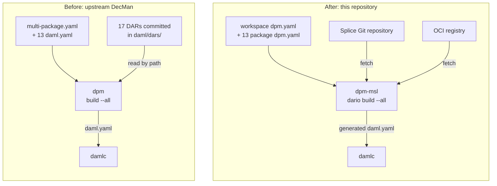

# PoC: building DecMan with advanced package-management capabilities in `dpm`

This proof of concept shows what advanced package-management capabilities in
`dpm` improve for a Canton app. We migrated the Daml build of
[Decentralization Manager](https://github.com/DLC-link/decentralization-manager)
(DecMan), a production Canton application with 13 packages, from `daml.yaml` to
`dpm.yaml`, a declarative manifest proposed by Moonsong Labs.

The main results:

1. **Less manual work.** `dpm.yaml` changes the developer experience:
   - Dependencies point directly at their OCI or Git source, instead of at DAR
     files copied into the repository.
   - Packages in the same workspace reference each other by name, so a
     version bump no longer means editing every dependent.
   - The workspace declares the SDK version once for all packages.
2. **A cleaner repository.** The build reads no committed DAR files and no
   hardcoded dependency paths.
3. **No change to the toolchain.** `dpm` generates the `daml.yaml` that `damlc`
   expects and calls the standard compiler. DecMan's application code is
   unchanged.

For DecMan, the build no longer reads any of the **17 third-party DARs** that
upstream commits, and it drops **24 versioned sibling paths** and **12
duplicate SDK declarations**.

> [!IMPORTANT]
> This demonstrates that a production Daml workspace can drop vendored DARs and
> hardcoded paths by moving to a declarative manifest, without changing its
> compiler or its application code.

## Improvements in `dpm`, applied to DecMan

This case study has two components:

- **`dpm-msl`**, a fork of `dpm` with advanced package-management
  capabilities. It reads `dpm.yaml`, fetches dependencies from their sources,
  and calls `damlc`.
- **This repository**, a fork of DecMan whose Daml packages build with
  `dpm-msl`. **Only the Daml build setup changed**; the application code is
  the same as upstream DecMan, which serves as the baseline.



The improvements live in `dpm`; DecMan is where we apply them and measure the
difference.

## The problem: a manual, file-based process

The
[Canton Network Developer Experience and Tooling Survey (2026)](https://forum.canton.network/t/canton-network-developer-experience-and-tooling-survey-analysis-2026/8412)
describes Daml dependency management this way:

> "a manual, file-based process."

Developers **download DAR files by hand**, **move them between folders**, and
**struggle to resolve version mismatches**.

## Context: symptoms in a production app

DecMan shows these symptoms, plus one the survey doesn't name: **configuration
duplicated across packages**. The baseline is upstream `main` at commit
[`b507e55`](https://github.com/DLC-link/decentralization-manager/commit/b507e5519c5d4bd8b8f5d0c6fe7c6548814fbf9f)
(DecMan v1.9.0). DecMan has **13 Daml packages** that depend on each other and
on **17 third-party DARs**, most of them from Splice and the Digital Asset (DA)
utility packages.

- **DARs downloaded and moved by hand.** All 17 third-party DARs are
  committed under `daml/dars/`, and the manifests reference them **68 times**
  by relative path. A DAR's origin and version exist only in its filename.
- **Version mismatches.** **24 references** to sibling packages hardcode a build
  path that includes the sibling's version, so a version bump means editing
  every dependent. Nothing checks consistency: `governance-token-custody-test`
  uses `splice-amulet` **0.1.17**, and every other package uses **0.1.19**.
- **Duplicated configuration.** The build is a `multi-package.yaml` plus **13
  `daml.yaml` files**, each with its own copy of `sdk-version: 3.4.11`.

We chose DecMan because it shows every symptom in one real codebase. It's a
production application, so the migration has to keep a real build working. Its
13 packages depend on each other, which exercises workspace handling and
sibling references. Its third-party DARs come from two kinds of
source, the public Splice Git repository and the DA utility packages, which
exercises both Git and OCI resolution. A migration that holds up here is
stronger evidence than one on a sample project.

## Three improvements, before and after

### 1. Dependencies declared by source, not copied in

⏪ **Before.** Each package lists vendored DARs by path. This excerpt is from
`governance-utility-onboarding/daml.yaml`:

```yaml
data-dependencies:
  - ../dars/splice-amulet-0.1.19.dar
  - ../dars/splice-api-token-holding-v1-1.0.0.dar
  - ../dars/utility-registry-v0-0.6.0.dar
  # ... 10 more
```

⏩ **After.** Each dependency names its source. Splice DARs come from the Splice
Git repository at a pinned commit, and DA utility DARs come from an OCI
registry. `dpm` fetches them into its cache:

```yaml
data-dependencies:
  splice-amulet:
    git: https://github.com/canton-network/splice
    commit: d5b780b5b636fe46f6f77e87c7655ddaf53c50fc
    path: daml/dars/splice-amulet-0.1.19.dar

  utility-registry:
    registry: main
    version: 0.6.0
```

> [!NOTE]
> For this case study, we republished the DA utility DARs and `testlib` to an
> OCI registry that we host. The registry allows anonymous reads.

✅ **Result:** the build reads **no DARs from the repository**, and every
dependency's origin is in its manifest.

### 2. Siblings referenced by name, not by versioned path

⏪ **Before.** A package depends on its sibling's build output, with the
sibling's version in the path:

```yaml
data-dependencies:
  - ../governance-action-v1/.daml/dist/governance-action-v1-0.1.0.dar
```

⏩ **After.** A package names its sibling:

```yaml
data-dependencies:
  governance-action-v1: member
```

`dpm` builds the sibling first, and the dependent compiles against the
sibling's current sources. Packages keep independent versions, because Daml
upgrade compatibility is per package, but **a version bump no longer requires
edits in dependents**.

✅ **Result:** the **24 versioned sibling paths are gone**. The `splice-amulet`
0.1.17 mismatch is not: it carried over unchanged, because each package still
declares its own copy of each third-party dependency. Workspace catalogs fix
this; see
[Catalogs to declare dependencies once](#2-catalogs-to-declare-dependencies-once).

### 3. One workspace, one SDK version

⏪ **Before.** `multi-package.yaml` lists the packages, and each of the 13
`daml.yaml` files repeats the SDK version.

⏩ **After.** One workspace manifest, [`daml/dpm.yaml`](daml/dpm.yaml), declares
the members, the SDK version, and the registries:

```yaml
schema: 1

workspace:
  name: token-trading
  sdk: 3.4.11
  members:
    - pkg/*

  registries:
    query:
      main: oci://zot.oceano.2networks.tech
    publish:
      main: oci://zot.oceano.2networks.tech
```

Each package sets `sdk: workspace`. To build everything, run
`dpm dario build --all` from `daml/`.

✅ **Result:** **one SDK declaration instead of 13**, and one file that defines
the workspace.

## Fewer moving parts

| Metric | Before (`daml.yaml`) | After (`dpm.yaml`) |
|---|---|---|
| Third-party DARs the build reads from the repository | 17 | **0** |
| Relative-path references to those DARs | 68 | **0** |
| Sibling references that hardcode a build path and version | 24 | **0** |
| Copies of the SDK version | 13 | **1** |
| Known version mismatches | 1 | 1 |

## What's new in `dpm-msl`

`dpm-msl` adds a declarative manifest, `dpm.yaml`, and the experimental
**`dpm dario` command set** that builds from it. This section explains each
new capability behind the DecMan improvements.

### A declarative manifest: `dpm.yaml`

`dpm.yaml` describes a package: its name, version, SDK, build arguments, and
dependencies. You declare each dependency by **what it is and where it comes
from**, never by a file path. This package manifest from DecMan uses every
dependency kind:

```yaml
schema: 1

package:
  name: governance-utility-onboarding-v1
  version: 0.4.0
  source: daml
  sdk: workspace

  dependencies:
    daml-script: builtin              # supplied by the SDK

  data-dependencies:
    governance-action-v1: member      # another package in the workspace

    splice-amulet:                    # a DAR in a Git repository
      git: https://github.com/canton-network/splice
      commit: d5b780b5b636fe46f6f77e87c7655ddaf53c50fc
      path: daml/dars/splice-amulet-0.1.19.dar

    utility-registry:                 # a package in an OCI registry
      registry: main
      version: 0.6.0
```

### Workspaces

A **workspace manifest** at the root lists its member packages with paths or
globs, such as `pkg/*`. It sets values that every member shares: the SDK
version, which members inherit with `sdk: workspace`, and named registries for
fetching and publishing. `dpm` discovers the workspace from any member
directory.

### Dependency resolution from the source

`dpm` resolves each dependency kind differently:

- **OCI.** `version` is a semantic-versioning requirement. `dpm` lists the
  package's tags in the registry and picks the highest version that satisfies
  it. An optional `digest` pins the exact artifact.
- **Git.** `dpm` fetches a DAR from a repository at a commit, branch, or tag,
  or from a GitHub release artifact.
- **`member`.** `dpm` builds the sibling package first, and the dependent
  compiles against its current sources.
- **`builtin`.** The SDK supplies the package, as it does today.

### A shared cache

Fetched artifacts go into a **global cache** shared by every project on the
machine, so `dpm` downloads each artifact once.

### Compatibility with `damlc`

`dpm` doesn't replace the compiler. It **generates the `daml.yaml` that
`damlc` expects**, with every dependency resolved to a cached file, and then
calls the standard `damlc`. Three commands cover the workflow:

| Command | What it does |
|---|---|
| `dpm dario build` | Resolves dependencies and builds the current package. With `--all`, builds every workspace member. |
| `dpm dario generate` | Writes the equivalent `daml.yaml` without building. |
| `dpm dario publish` | Builds the package and publishes it to an OCI registry. |

### Validation before the build

`dpm` validates every manifest before it builds. An unknown registry name, a
`member` dependency that names no package in the workspace, or a malformed
version requirement **fails with a clear error** instead of a missing file
halfway through compilation.

## The future: further improvements to the developer experience

### 1. Lockfile

Committing DARs had one real benefit: **every checkout built against the same
bytes**. Fetching from a registry gives that up. Git dependencies pin a commit,
but OCI dependencies resolve to a tag, and a registry can move a tag to
different content. The schema lets you pin an OCI DAR with `digest`, but this
repository doesn't, because maintaining digests by hand across 13 packages is
error-prone.

> [!IMPORTANT]
> **A lockfile restores the guarantee.** It records the checksum of every
> resolved artifact and fails the build when a fetched artifact doesn't match.
> `dpm-msl` doesn't have one yet, and it's the next thing to build.

### 2. Catalogs to declare dependencies once

Each package declares its Git and OCI dependencies in full, so the same Splice
commit appears **40 times**. Workspace catalogs let a workspace declare each
third-party dependency once, which also removes the place where mismatches
hide:

```yaml
workspace:
  catalogs:
    splice:
      splice-amulet:
        git: https://github.com/canton-network/splice
        commit: d5b780b5b636fe46f6f77e87c7655ddaf53c50fc
        path: daml/dars/splice-amulet-0.1.19.dar
```

`dpm-msl` parses and validates `catalogs`, but packages can't
reference them yet.

### 3. Smart, deep conflict resolution

Resolve conflicting version requirements across the whole dependency tree.

### 4. Source code dependencies

Depend on a package's source code, not only on its compiled DAR.

### 5. Local cache for partial builds

Cache intermediate builds, so `dpm` rebuilds only the packages that changed.
