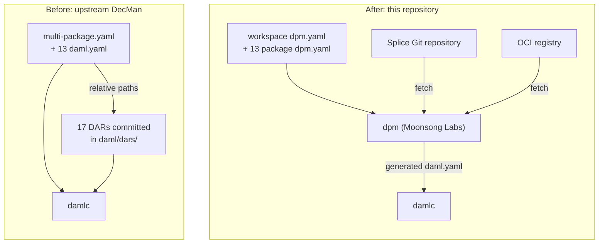

# Case study: building Decentralization Manager with `dpm.yaml`

We migrated the Daml build of
[Decentralization Manager](https://github.com/DLC-link/decentralization-manager)
(DecMan), a production Canton application with 13 packages, from `daml.yaml` to
`dpm.yaml`, using **dpm (Moonsong Labs)**: our fork of `dpm` with advanced
package-management capabilities. After the migration, the build reads none of
the 17 third-party DARs that upstream commits, and it drops 24 versioned sibling
paths and 12 duplicate SDK declarations. Version mismatches, longer manifests,
and the loss of byte-identical inputs remain open until workspace catalogs and a
lockfile land.

## Set up the comparison

This case study has two pieces, both built by Moonsong Labs:

- **dpm (Moonsong Labs)**, a fork of `dpm` with advanced package-management
  capabilities. It reads `dpm.yaml`, fetches dependencies from their sources,
  and calls `damlc`. Its source is the private repository
  `Moonsong-Labs/dpm-priv`.
- **This repository**, a fork of DecMan whose Daml packages build with dpm
  (Moonsong Labs). Only the Daml build setup changed; the application code is
  the same as upstream DecMan, which serves as the baseline.



## Identify the problem

The
[Canton Network Developer Experience and Tooling Survey (2026)](https://forum.canton.network/t/canton-network-developer-experience-and-tooling-survey-analysis-2026/8412)
describes Daml dependency management as "a manual, file-based process."
Developers download DAR files by hand, move them between folders, and
struggle to resolve version mismatches.

DecMan shows these symptoms, plus one the survey doesn't name: configuration
duplicated across packages.

## Find the problem in DecMan

The baseline is upstream `main` at commit
[`b507e55`](https://github.com/DLC-link/decentralization-manager/commit/b507e5519c5d4bd8b8f5d0c6fe7c6548814fbf9f)
(DecMan v1.9.0). DecMan has 13 Daml packages that depend on each other and on
17 third-party DARs, most of them from Splice and the Digital Asset (DA)
utility packages.

- **DARs downloaded and moved by hand.** All 17 third-party DARs are
  committed under `daml/dars/`, and the manifests reference them 68 times by
  relative path. A DAR's origin and version exist only in its filename.
- **Version mismatches.** 24 references to sibling packages hardcode a build
  path that includes the sibling's version, so a version bump means editing
  every dependent. Nothing checks consistency: `governance-token-custody-test`
  uses `splice-amulet` 0.1.17, and every other package uses 0.1.19.
- **Duplicated configuration.** The build is a `multi-package.yaml` plus 13
  `daml.yaml` files, each with its own copy of `sdk-version: 3.4.11`.

## Extend dpm

dpm (Moonsong Labs) adds a `dpm dario` command set to `dpm`. It reads a
declarative manifest, `dpm.yaml`, resolves each dependency from where it
lives, generates the `daml.yaml` that `damlc` expects, and calls the standard
`damlc`. The schema is specified in
`pkg/dario/dpm-yaml-schema.md` in `Moonsong-Labs/dpm-priv`.

| Capability | Status in dpm (Moonsong Labs) |
|---|---|
| `dpm.yaml` manifests for packages and workspaces | Done |
| Workspaces: member globs, shared SDK version, and registries | Done |
| Dependencies from OCI registries, by semantic-versioning requirement | Done |
| Dependencies from Git, by commit, branch, tag, or release artifact | Done |
| Shared global cache for fetched artifacts | Done |
| `member` dependencies between workspace packages | On branch `feat/member-dep-support`, not merged |
| Workspace catalogs | Parsed and validated, not usable from packages |
| Lockfile with artifact checksums | Not started |

## Migrate DecMan to `dpm.yaml`

### Replace vendored DARs with their sources

**Before.** Each package lists vendored DARs by path. This excerpt is from
`governance-utility-onboarding/daml.yaml`:

```yaml
data-dependencies:
  - ../dars/splice-amulet-0.1.19.dar
  - ../dars/splice-api-token-holding-v1-1.0.0.dar
  - ../dars/utility-registry-v0-0.6.0.dar
  # ... 10 more
```

**After.** Each dependency names its source. Splice DARs come from the Splice
Git repository at a pinned commit, and DA utility DARs come from an OCI
registry. `dpm` fetches them into its cache:

```yaml
data-dependencies:
  splice-amulet:
    git: https://github.com/canton-network/splice
    commit: d5b780b5b636fe46f6f77e87c7655ddaf53c50fc
    path: daml/dars/splice-amulet-0.1.19.dar

  utility-registry:
    registry: main
    version: 0.6.0
```

For this case study, we republished the DA utility DARs and `testlib` to an
OCI registry that we host. The registry allows anonymous reads.

**Result:** the build reads no DARs from the repository, and every
dependency's origin is in its manifest.

### Reference sibling packages by name

**Before.** A package depends on its sibling's build output, with the
sibling's version in the path:

```yaml
data-dependencies:
  - ../governance-action-v1/.daml/dist/governance-action-v1-0.1.0.dar
```

**After.** A package names its sibling:

```yaml
data-dependencies:
  governance-action-v1: member
```

`dpm` builds the sibling first (on the `feat/member-dep-support` branch), and
the dependent compiles against the
sibling's current sources. Packages keep independent versions, because Daml
upgrade compatibility is per package, but a version bump no longer requires
edits in dependents.

**Result:** the 24 versioned sibling paths are gone. The `splice-amulet`
0.1.17 mismatch is not: it carried over unchanged, because each package still
declares its own copy of each third-party dependency. Workspace catalogs fix
this; see
[Close the remaining gaps](#close-the-remaining-gaps).

### Declare the workspace once

**Before.** `multi-package.yaml` lists the packages, and each of the 13
`daml.yaml` files repeats the SDK version.

**After.** One workspace manifest, [`daml/dpm.yaml`](daml/dpm.yaml), declares
the members, the SDK version, and the registries:

```yaml
schema: 1

workspace:
  name: token-trading
  sdk: 3.4.11
  members:
    - pkg/*

  registries:
    query:
      main: oci://zot.oceano.2networks.tech
    publish:
      main: oci://zot.oceano.2networks.tech
```

Each package sets `sdk: workspace`. To build everything, run `dpm dario build`
from `daml/` with a build of dpm (Moonsong Labs) that includes `member`
support.

**Result:** one SDK declaration instead of 13, and one file that defines the
workspace.

## Restore byte-identical inputs

Committing DARs had one real benefit: every checkout built against the same
bytes. Fetching from a registry gives that up. Git dependencies pin a commit,
but OCI dependencies resolve to a tag, and a registry can move a tag to
different content. The schema lets you pin an OCI DAR with `digest`, but this
repository doesn't, because maintaining digests by hand across 13 packages is
error-prone.

A lockfile restores the guarantee. It records the checksum of every resolved
artifact and fails the build when a fetched artifact doesn't match. dpm
(Moonsong Labs) doesn't have one yet, and it's the next thing to build.

## Measure the results

| Metric | Before (`daml.yaml`) | After (`dpm.yaml`) |
|---|---|---|
| Third-party DARs the build reads from the repository | 17 | 0 |
| Relative-path references to those DARs | 68 | 0 |
| Sibling references that hardcode a build path and version | 24 | 0 |
| Copies of the SDK version | 13 | 1 |
| Known version mismatches | 1 | 1 |
| Non-blank manifest lines | 277 | 484 |

Line counts cover every `daml.yaml` plus `multi-package.yaml` before, and
every `dpm.yaml` after.

## Close the remaining gaps

### Shrink manifests with catalogs

Manifests grew from 277 to 484 non-blank lines, because each package declares
its Git and OCI dependencies in full. The same Splice commit appears 40 times.
Workspace catalogs let a workspace declare each third-party dependency once,
which also removes the place where mismatches hide:

```yaml
workspace:
  catalogs:
    splice:
      splice-amulet:
        git: https://github.com/canton-network/splice
        commit: d5b780b5b636fe46f6f77e87c7655ddaf53c50fc
        path: daml/dars/splice-amulet-0.1.19.dar
```

dpm (Moonsong Labs) parses and validates `catalogs`, but packages can't
reference them yet.

### Account for the remaining DARs

Two folders still hold DARs, and the build reads neither:

- `daml/dars-to-publish/` holds 7 third-party DARs, the copies used to seed
  the OCI registry. Phase 1 removes them.
- `releases/` holds first-party DARs that the DecMan server uploads to Canton
  at runtime. They're application assets, so this migration leaves them in
  place.

### Answer open design questions

- How should a package reference a catalog entry? One option is a `catalog:`
  key on the dependency that names the catalog.
- What should the lockfile record, and where should it live in a workspace?

### Plan the next phases

Phase 1: migration

- [x] Migrate all 13 packages to `dpm.yaml` with a workspace manifest.
- [x] Replace sibling paths with `member` dependencies.
- [x] Replace committed third-party DARs with OCI and Git dependencies.
- [ ] Merge `member` resolution into the `dario` branch of dpm (Moonsong Labs).
- [ ] Rename the workspace from `token-trading`, a leftover from an example.
- [ ] Remove `daml/dars-to-publish/` and document how the registry was seeded.
- [ ] Record a clean build from a fresh clone with an empty cache.

Phase 2: workspace catalogs

- [ ] Implement package-side catalog references in dpm (Moonsong Labs).
- [ ] Move Splice and DA utility declarations into `workspace.catalogs`.
- [ ] Resolve the `splice-amulet` 0.1.17 and 0.1.19 mismatch.
- [ ] Remeasure manifest size.

Phase 3: lockfile

- [ ] Implement a lockfile in dpm (Moonsong Labs) that records artifact
      checksums.
- [ ] Commit the lockfile and show that a changed artifact fails the build.

Out of scope: moving `releases/` to OCI, which requires DecMan runtime
changes, and re-enabling CI on this fork.
